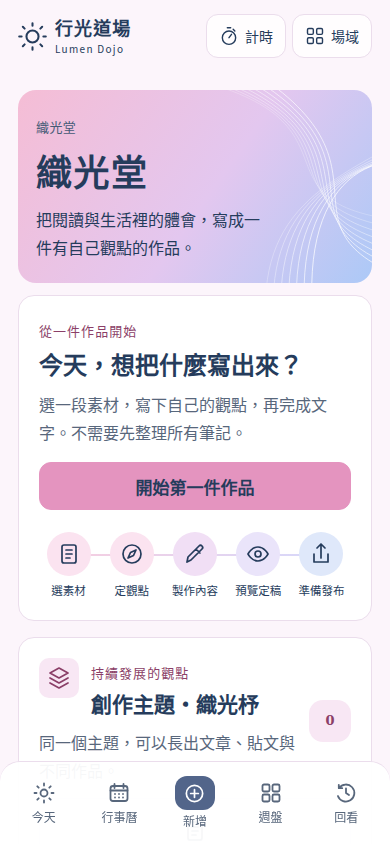
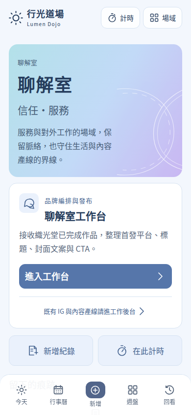

# 織光堂與聊解室：第一包交付

2026-10-20。分支 `codex/weaving-liaojie-creation-v2`；本機驗證基準 `8523e2c`（含獨立審查後修正），已整合 master `6dd62be`（含 PR99 導覽／週盤配色與最新行事曆主題），保留 PR98 行事曆修正。GitHub 實作 checkpoint `3fd5d03c27a15f91eefb5cd0e46ffd5b05c5f597`，PR [#100](https://github.com/tasiling/Lumen-Dojo/pull/100)。這是待審閱版本，尚未合併或部署。PR89 閱讀／知識整合未加入本包。

## 可操作的結果

- 織光堂首頁與編輯器共用五步定義、線性 SVG 圖示及正式 CSS：選素材、定觀點、製作內容、預覽定稿、準備發布。
- 新作品先選生活片段或閱讀選摘，再寫觀點。前兩步只保留本分頁草稿；明確按「建立第一件作品」才 POST。重新整理恢復來源模式、選摘 ID／版本／範圍、觀點與文字形式；成功回應後才清除草稿。
- 沿用已有的來源選摘、保存、離開保護、版本衝突比較、固定成品及手動交接。未知建立結果以相同輸入重試共用操作收據，驗收未重複建立。
- 聊解室依「接收作品／編排首發版本／預覽首發版本／發布紀錄」分段，新增真正可讀寫的 Threads 平台。來源文字及固定成品版本不受發布編排影響；日期安排不代表外站已發布。
- IG 輪播文字與口播稿明示交付範圍，沒有宣稱已生成圖片、錄音或影片。

## 與參考圖的核對

| 設計規則 | 實作與預覽 |
| --- | --- |
| 粉紫藍織光堂、淺藍紫聊解室，白色卡片 | 真實路由套用相同樣式；交織線／交談圓弧為 SVG |
| 圖示讓人理解步驟 | 首頁導覽及工作區同一 `CREATIVE_STEPS`；僅目前步驟有標記，點開不等於完成 |
| 大標、清楚主操作、手機單欄 | 路由限定無襯線文字與欄位，保留開始／繼續、作品清單與底部五入口 |
| 預覽等於實際版本 | 沒有另外繪製假介面。下方圖片、測試及可操作預覽皆來自待合併產品的 React 元件與 CSS |
| 可讀性修正 | 粉色主按鈕採深藍文字（4.94:1），取代參考圖較低對比的白字；聊解室入口白字藍底 4.60:1、保存主操作白字深粉底 6.98:1 |
| 真實內容與狀態 | 作品／選摘、未保存、錯誤、比較、定稿及交接皆保留實際操作；有資料時不套空白示意圖 |

這是設計規則與同源元件的一致性，不宣稱參考照片與所有真實資料畫面逐像素相同。標題、字數、載入與資料狀態會合理改變高度。




## 可操作的隔離預覽

```bash
npm ci
npm run build
npm run preview:creative
```

開啟 `http://127.0.0.1:3045/weaving` 或 `/liaojie`。使用正式 production bundle，只允許 loopback 與相同來源，啟動前拒絕通用、開發及正式環境設定檔；示範資料、API 寫入與選摘全部位於程序記憶體，不使用正式 Notion。預覽載有一件可繼續修改的作品與其已交接固定版本，編排與來源可互相比對。`node scripts/creative-interface-preview.mjs --empty` 開啟空白示範。Ctrl-C 關閉；資料不保留到正式系統。這不是已部署網址。

## 驗收證據

| 驗收 | 結果 |
| --- | --- |
| `npm run build` | 成功，Next 16.2.10 production bundle |
| `npx tsc --noEmit` | 成功 |
| `npm run lint` | 0 errors；2 個既有 warnings（Plurk img、weekly test 未使用 import） |
| `npm run test:weaving` | 領域、API、防重、選摘、草稿、成品與回歸通過 |
| `UI_PRODUCTION=1 npm run test:weaving-clarity` | 空白開始、失敗重試、保存後前進、定稿交接通過 |
| `npm run test:creative-interface` | production 真實路由 UI＋可操作預覽通過 |
| `node scripts/test-today-calendar-components.mjs` | 合併 master 後的共用導覽／行事曆保留檢查通過 |
| 尺寸 | 375／390／430px 手機、1024px 擴充，320px 無橫向溢出；390×450 低高度操作列留在畫面範圍 |
| 狀態 | 空白／非空、未保存、保存失敗不前進、版本衝突比較、定稿與固定版本交接 |
| 來源模式恢復 | 閱讀選摘 ID／版本／起訖與來源模式在重新整理後保持一致，實際建立仍由 API 核對版本 |
| 無法保存本機草稿 | 收起／SPA 切換先顯示離開保護；失敗時留在表單，恢復儲存後只本機保存，沒有 POST 建立 |
| 正式設定檔隔離 | `.env.production` 與 `.env.production.local` 均在伺服器啟動前被拒絕 |
| 未知結果恢復 | 模擬後台成功但回應遺失，重整後以原資料重試仍只有一件新增作品 |

中文字體等待載入後擷取；測試環境使用可用的 Noto Sans CJK TC 與系統 fallback。字體、元件及樣式與產品走相同宣告。所有截圖為隔離資料，未做 iPhone 真機或正式 Notion 寫入驗收。低高度測試不等同全部手機鍵盤行為已驗證。

錯誤與交接畫面：

- [保存失敗](creative-interface-evidence/work-save-failed-390.png)
- [版本衝突比較](creative-interface-evidence/work-conflict-390.png)
- [固定成品交接](creative-interface-evidence/work-handoff-390.png)

## 實作取捨與已修正問題

- 步驟以消費它們的真實 UI 驗證，沒有只比常數陣列；代價是 UI 測試較慢，但能抓到圖示、動作及實際文字不一致。
- 建立表單改用獨立的型別化本機草稿輔助函式，沿用原快取 key 及操作收據；原 hook 的「保存後離開」會觸發建立 API，因此不繼續讓它負責建立草稿。其他作品編輯仍用原 hook。代價是建立與既有作品的儲存生命週期分開。
- 可操作預覽限制在本機 loopback 的 production bundle；代價是需啟動預覽，沒有公開預覽網址；避免在正式應用增加 fixture 端點。
- 預覽以 production 執行，移除開發 HMR 及浮動開發面板的影響；開發伺服器測試採循序執行，避免修改程式時熱重載中斷導覽。
- 實際發布測試抓到 PATCH 的舊平台白名單；已改與 `LIAOJIE_PLATFORMS` 共用契約。
- 視覺核對抓到工作區舊 CSS 蓋回棕色；已增加真實元件漸層檢查並修正限定選擇器。低高度列也移除舊置中 transform，實際邊界檢查通過。

## 獨立審查與修正

獨立、唯讀、全分支審查發現 0 項 Critical、2 項 Important、0 項 Minor。兩項 Important 已以失敗先行的回歸測試修正：

1. 本機儲存失敗時收起／SPA 導覽可能丟失建立輸入：補回只做本機保存的離開保護，並保護建立中操作。儲存失敗、取消離開、再次保存與恢復輸入皆通過；離開保存不呼叫建立 API。
2. Production 預覽可能讀入正式 dotenv：啟動檢查補齊 `.env.production`／`.env.production.local`，兩個檔名都以隔離 sentinel 檔驗證啟動前拒絕。

修正後重跑 production build、TypeScript、lint、完整織光領域／API回歸、創作 UI／預覽、clarity 流程，全部通過；lint 保留上述 2 個既有 warnings。沒有待延後 Minor。

審查未獨立判斷的範圍與本次裁決：iPhone 真機／裝置字體保留為未驗收邊界；原參考圖片由主要實作者與產品截圖核對，並記錄對比修正，沒有逐像素相同聲明；正式 Notion 依授權不用真實寫入驗證，因此保留 live-write 驗收缺口。

## 最新 master 整合補記

PR 建立期間 master 增加 `6dd62be`。已保留其行事曆主題／圖案與 header 改動，解決 DojoShell 及 CSS import 衝突。合併後再次 production build、創作 UI／隔離預覽、lint 與行事曆元件檢查通過；行事曆原 QA 在 dev 通過全部尺寸、操作及零寫入檢查。

額外的行事曆 production QA 在跨回首頁的測試流程中收到了 React #418 hydration 錯誤；日期框、配色、環形深度、篩選與 modal assertions 已走完，但該整體 production QA **未通過**。改用真實時鐘仍重現，尚未定位原因，因此沒有把它列為已通過，也沒有直接修改其他工作區的產品行為。這是整合／發布驗收需要追蹤的項目；本包創作路由 production 操作測試仍全數通過。

遠端保存使用 GitHub Git Data：保留提交父鏈與 master merge parent，各 tree SHA 與本機已驗證 tree 相同，expected_sha、非 force 更新；本機驗證 SHA 與 GitHub 提交 SHA 因提交 metadata 不同而不同。

## 下一包與尚未交付

下一包是來源／閱讀知識整合與讀取、公開設定；先重新核對 PR89 及當時 master，處理衝突再整合。點點主動提案、三平台文字版本、圖文製作與外部工具實際試用、短影音、Podcast、短漫與長影片仍依路線圖續建，本包不算已完成。受眾、工具預算、外部搜尋範圍與頻率保持可設定，沒有新增私人資料的預設取材許可。
