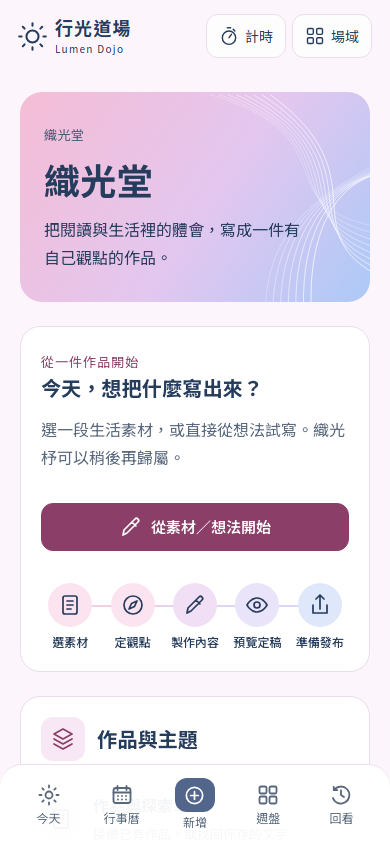
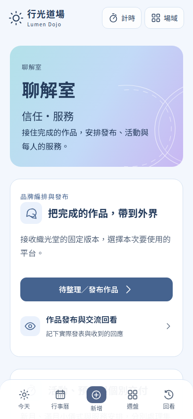
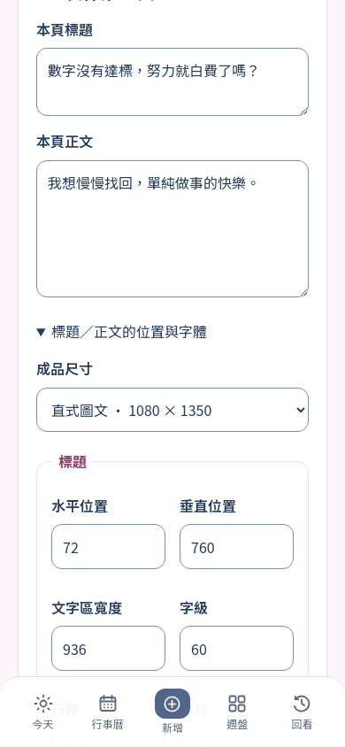

# 織光堂／聊解室 UI 對齊交付

2026-10-31（墨爾本）。PR107，同一分支 `codex/weaving-liaojie-native-integration`。程式 checkpoint `1f808c3246b02c54bad1ff319ac9a2ac0201ab2c`，tree `877069d51d849b471b57cf7c55ac8522fea8e747`，與本機驗證內容完全一致；後續文件提交以 PR 最新 head 為準。尚未合併／部署，未讀寫正式 Notion。

## 視覺與操作修正

| 問題 | 本輪修正 |
| --- | --- |
| 外殼、原生工作區與工具各自定義色彩／字型 | 沿用粉紫織光堂、粉藍聊解室、原漸層與 SVG；共用深藍正文、場域主色及表單層級 |
| 手機與桌面都被限制成窄欄 | 手機單欄；外殼可延伸至 1080px，桌面首頁兩欄；長文保留閱讀寬度 |
| 入口缺乏辨識度 | 首頁加流程圖示、用途說明與接續入口；次要素材／語氣／備份收在可展開區，沒有移除功能 |
| 欄位、勾選與按鈕尺寸混雜 | 文字欄位預設 16px、控制點選區至少 44px，checkbox 22px 配完整標籤；input／select 高度一致，textarea 保留自訂高度 |
| 活動／圖文雙欄標籤換行後錯位 | 輸入基準底部對齊；放大文字時數字與選單原生高度也一致 |
| 舊進度提示有白色選取底板 | 保留 SVG 圓形引導與紅色外框，背景透明；正常字體的階段文字維持一行 |
| 按鈕共用樣式破壞舊素材卡 | 普通控制保留元件自己的排列與間距；flex 只用於明確的行動按鈕／連結，來源標題、位置、摘錄和選取入口重新直向排列 |
| 放大文字時舊保存列被導覽擋住 | 新舊保存列共用導覽高度與安全區偏移；低高度時回到文件流，保持欄位與操作可到達 |
| 工具入口使用不一致符號 | 原工具入口改為同系列 SVG；行事曆與知識鑽石新增對應圖示，保留原工具及裝置備份 |

使用的 UI 技能：UI/UX Pro Max（觸控、焦點、表單、對比與放大文字）、frontend-design（層級、中文字型、對齊與文案）、Awesome Design Skills（Friendly 的柔和基調、Bento 的間距節奏）。沿用已確認品牌，未換成別的風格或新增 UI 套件。

## 實際驗證

- **105／105**：15 個實際 React 畫面 × 7 個設定。320／375／390／430／1024px、844×390 橫向、390px 的 200% 根字體。包含兩首頁、來源、A/B/C/D、定稿、交接、圖文編輯、活動、發布表單、原工具入口，以及有資料的舊 SourcePicker／舊模板。元件與編譯後 CSS 皆與產品同源。
- 幾何檢查包含欄位與控制超界、點選尺寸、文字欄位字級、場域按鈕顏色、正常字體階段換行、雙欄輸入基準、內容卡的直向排列，以及舊保存列與導覽的實際重疊。
- 正常按鈕有真實轉場，減少動態設定下轉場歸零。`results.json` 是最後一次完整矩陣，非先前 77 案例的結果。
- `npm run build`、`npx tsc --noEmit`、受影響 TypeScript ESLint、`git diff --check` 通過；原生領域／API 11 組測試程式通過。
- 實際色彩對比：深藍正文／白底 11.17:1、次要文字／白底 5.76:1、白字／粉紫主按鈕 6.98:1、白字／藍色主按鈕 6.11:1；文字欄位邊界／白底 3.30:1。
- 執行：先 build，再 `node scripts/test-creative-ui-alignment.mjs`；本環境透過 `STUDIO_BROWSER_PATH` 使用既有 Chromium，沒有安裝替代瀏覽器或改動網路限制。SSR 用合成資料初始化實際編輯元件的狀態；不把它當成已完成 API 水合互動。

逐案量測：[results.json](creative-ui-alignment-evidence/results.json)。

### 審查與修正

獨立唯讀審查固定範圍 `7e64cc9..86c17ae`：0 Critical／2 Important／1 Minor。圖文欄位錯位與本輪主要需求直接相關，升為 Important 一起修正。三項均有實際失敗重現及修正後回歸：

1. 真實 SourcePicker 元件配一份合成閱讀筆記：卡片排列在 7 個設定失敗；恢復元件排列後通過。另以正常階段文字換行案例確認共用 padding 不再擠壓進度引導。
2. 真實 TextWorkspace 的保存列：200% 字體與導覽重疊失敗；共用導覽高度後通過。
3. 圖文雙欄：用審查時實際 CSS 快照重現 200% 字體錯位；底部對齊及一致控制高度後通過。測試依實際欄位 x 座標分組，避免 fieldset 的未解析 grid track 產生錯誤分組。

只有一次獨立審查；修正由 RED→GREEN 與完整矩陣驗證，沒有聲稱第二次審查。沒有延後的 Minor。

## 裁定、代價與驗收界線

- 已有完整品牌方向與 Native 授權，本輪直接修正；在原獨立 checkout 保留既有成果並延續 PR107。例行視覺選擇可在 PR 修訂，沒有另開平行產品。
- 以實際渲染檢查 UI，資料契約沿用領域／API 測試；代價是這些證據無法取代水合後保存／衝突或 iPhone Safari 真機操作。
- Railway 讀取回覆需重新驗證；受管預覽 CLI 回報啟動，但本輪雲端瀏覽器顯示「無法載入」，重載一次仍失敗。代價是**本輪新 UI 的線上互動未驗收、未部署**；未要求本人登入或以替代路徑改正式資料。
- 審查未判定的正式 DOM／資料、實體 Safari 的鍵盤／安全區／原生選單，均保持發布前驗收；A/C 已補入渲染，但所有原工具的互動並非本輪全數重驗。
- 原工具入口外殼已對齊，五份原工具 iframe 內部 HTML、版型及裝置資料保留。代價是相容工具內部仍有各自原介面；其完整原生轉換沿用既有後續工作包。
- 圖文控制錯位升級修正，代價是一條共用控制高度規則與更精確的欄位回歸；不影響圖文內容、保存版本或輸出座標。

## 畫面

以下是產品 React／CSS 的合成資料渲染，非已部署站台截圖。

