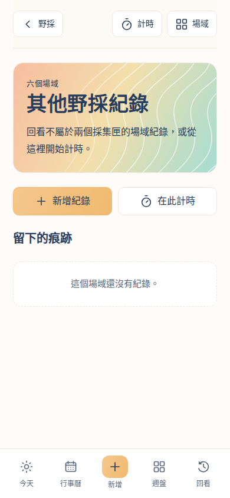
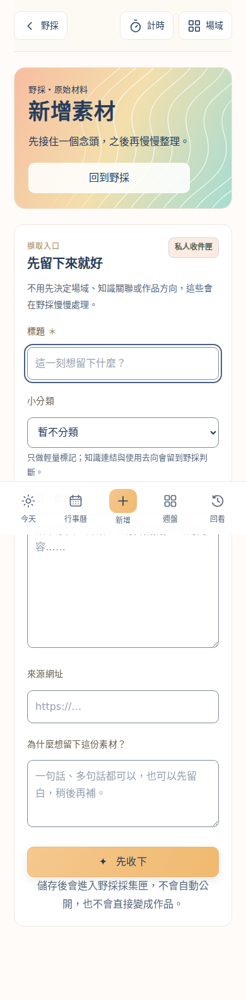

# 野採新版視覺全面對齊

基準：`4655f78`；沿用已確認的蜜橙、白卡、深藍文字與山徑等高線，不另換品牌方向。

## 調整範圍

- 英文影像匣、一般採集匣及新增素材共用帶山徑圖紋的蜜橙漸層頁首。
- 其他野採紀錄移除遺留深藍主視覺，套用同一漸層與 SVG 圖示；原有紀錄來源、編輯、刪除及計時行為沿用。
- 英文詳情、一般素材詳情、空白狀態、紀錄卡、編排進度與紀錄彈窗統一色彩、字級、留白和按鈕。
- 野採底部五入口對齊新版導覽寬度及中央新增動作，保留手機安全區。
- 新增素材頁返回上一層野採，修正先前跳回今天的對照缺漏。

樣式限定於 `forage-shell`，保留錯誤紅色、實際資料和既有功能。共用元件新增可選的裝飾插槽，未提供時保持原輸出；其他場域不套用本次 CSS。

## 驗證

- Production build（包含 TypeScript）通過。
- `npm run test:forage-ui`：路由、SSR、手動例句、來源保留、重新開啟草稿及主張保存回歸。
- `UI_PRODUCTION=1 npm run test:forage-mobile`：以 production bundle 及隔離 API 驗證派送／失敗部分重試、草稿跨分頁保留、新增素材、編排完整流程、淡出素材深連結、紀錄彈窗及無橫向溢出。
- 首頁測試 320／375／390／430／1024px；四個子頁分別測試 320／390／1024px 的實際漸層、文字顏色、圖紋、導覽寬度及置中。
- `node scripts/test-today-calendar-components.mjs`：共用殼層及今日／行事曆隔離回歸通過。
- `git diff --check` 通過。獨立靜態審查無 Critical／Important／Minor 問題。

瀏覽器使用 Chromium；載入 Noto Sans／Serif CJK TC 後檢查中文排版。所有 UI 測試使用隔離資料與 API，不寫正式資料，不呼叫付費 AI。實體 iPhone Safari 尚未驗收。

## 手機畫面

