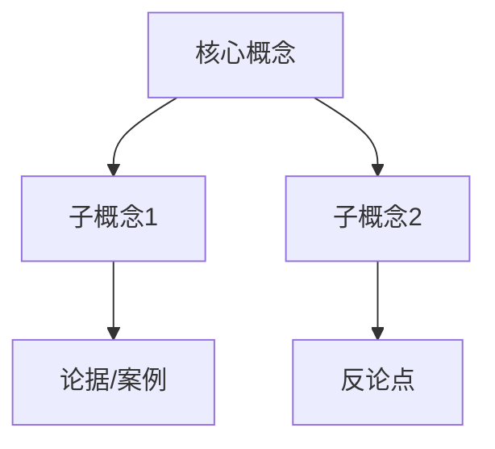

# 100 Angles — 可视化图谱建议

本文件为各角度的分析结果提供**可落地的图谱画法**。优先用纯 Markdown / ASCII / Mermaid，
不依赖外部工具，复制即可渲染。

---

## 1. 概念图谱（#29）/ 逻辑依赖树（#34）/ 思想谱系（#31）

用 Mermaid 流程图或文本缩进树：



纯文本 fallback（无渲染环境时）：

```
核心概念
├─ 子概念1
│   └─ 支撑论据
└─ 子概念2
    └─ 反论点（见 #51）
```

## 2. 引力场图（#07 重力分析）

用 ASCII 标注引力井（核心论点）、真空区（回避话题）、拉格朗日点（平衡处）：

```
        ☄ 真空区：AI 风险
              │
   🪐 论点B ──⚫ 引力井(核心论点) ──🪐 论点C
              │
        🌑 真空区：伦理代价
   （⚖ 拉格朗日点：在 B/C 张力间的微妙平衡）
```

## 3. 情感曲线（#93）

用 ASCII 折线表示读者情绪的起伏（纵轴=强度，横轴=章节）：

```
情绪
高 │        ╱╲        ╱╲
   │   ╱╲ ╱  ╲      ╱  ╲___
中 │ ╱  ╳    ╲╱╲  ╱
低 │╱          ╲╱
   └─────────────────────── 章节
   引子 冲突 低谷 顿悟 反转 尾声
```

## 4. 信噪比图谱（#10）/ 压缩极限（#61）

每章一行条形（█=信号，░=噪声），末尾给总压缩率：

```
第1章 ████████░░  80% 信号
第2章 █████░░░░░  50% 信号
第3章 ███████░░░  70% 信号
...
全书可压缩至原篇幅 ≈ 35% 而不失核心。
```

## 5. 域覆盖矩阵（全景扫描汇总用）

用一个 14×N 的勾选矩阵，快速看出哪些域产出强洞察、哪些偏弱：

| 域 | 产出洞察强度 | 备注 |
|----|:---:|------|
| 解剖 | ★★★★ | 结构清晰 |
| 翻译 | ★★★ | 多个隐喻有效 |
| 应力 | ★★★★★ | 发现关键反例 |
| ... | | |

## 6. 负空间地图（#78-#84）

用"书说了 / 书没说"双栏对照，直观暴露留白：

| 书明说的 | 书沉默的（负空间） |
|---------|------------------|
| 个人努力决定成败 | 结构性不公如何限制努力 |
| 方法论可复制 | 哪些人群被排除在前提外 |

---

> 画图原则：**一张图只表达一个维度**，避免把多个角度塞进一张图导致不可读。
> 若输出环境不支持 Mermaid，一律退回文本/ASCII 版本。
